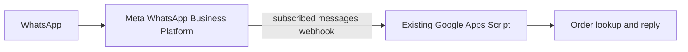

# Flow

Current configuration observed on 2026-11-27:

Production delivery for the intended number has not been verified. The storefront's WhatsApp links open a chat separately from this webhook. The new order sheet is not connected to this flow.

The intended order intake needs authenticated Meta events, durable deduplication by message ID, preservation of the original message, and retryable delivery to the sheet. The existing lookup behavior must continue. The local parser is not a running integration.
